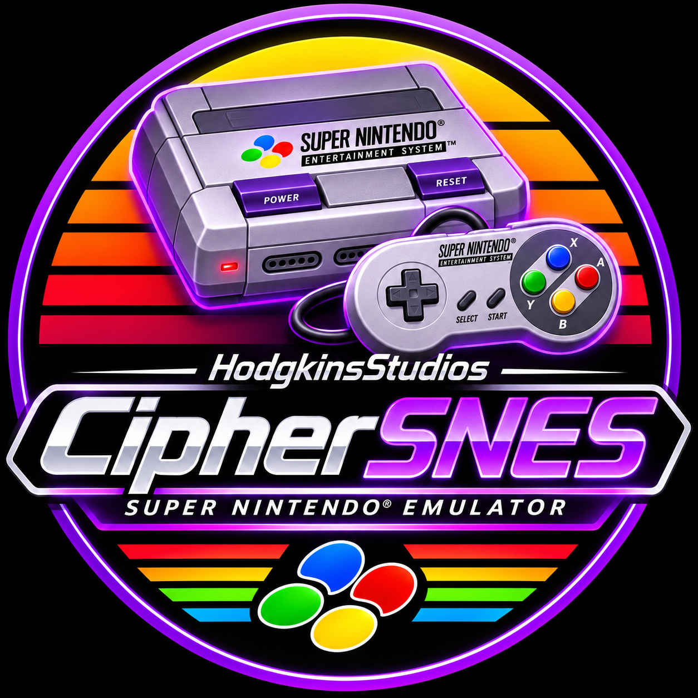

<div align="center">



# CipherSNES

**Super Nintendo / Super Famicom emulator**  
**HodgkinsStudios · C++17 · Linux · Windows · macOS**

[](https://github.com/HodgkinsStudios/CipherSNES/actions/workflows/linux-ci.yml)


[](LICENSE)

[Build instructions](docs/PLATFORMS.md) · [Accuracy and compatibility](docs/ACCURACY_STATUS.md) · [Changelog](CHANGELOG.md)

</div>

> **v0.1 release candidate:** This branch is prepared for a fresh v0.1 release. Native builds and final packages must pass GitHub Actions and platform-level testing before publishing a release. No downloadable release is claimed to exist yet.

## About

CipherSNES is a C++17 Super Nintendo / Super Famicom emulator with a reusable emulation core and desktop frontends. The existing Linux X11 frontend is retained; a GTK3/SDL2 frontend is available for Linux, Windows and macOS.

The emulator is under active development; current code must not be interpreted as complete cycle-accurate SNES hardware emulation.

## Capabilities

- CPU: 65C816 execution, interrupt handling, DMA/HDMA and cartridge bus
- Video: SNES PPU rendering and presentation
- Audio: SPC700/S-DSP emulation and SDL2 audio output
- Cartridges: ROM file loading and supported ROMs in ZIP archives
- Input: configurable keyboard controls and supported SDL2 gamepads
- Persistence: user-local save data and emulator settings
- Additional hardware: selected enhancement-chip functionality under development

Features have differing degrees of completeness; see [the accuracy report](docs/ACCURACY_STATUS.md) for evidence and limitations.

## Platform support for v0.1

| Platform | Frontend | Planned GitHub Actions artifact |
| --- | --- | --- |
| Linux x86_64 | X11 / XWayland | AppImage |
| Linux x86_64 | GTK3 / SDL2 | Flatpak |
| Windows x64 | GTK3 / SDL2 | ZIP with runtime libraries |
| macOS Apple Silicon | GTK3 / SDL2 | `.app` ZIP (ARM64) |
| macOS Intel | GTK3 / SDL2 | `.app` ZIP (x86_64) |

The same new CipherSNES artwork is used in the README, both frontends' About windows, desktop/window icons, Windows executable resource and macOS app bundle. The previous logo is no longer part of the project.

After GitHub Actions completes, download packages from the **Actions → 0.1 release packages** workflow, or attach them to the new GitHub v0.1 Release after verification. The workflow produces a combined ZIP and per-platform artifacts.

## Build from source

You will need CMake 3.20 or newer and a C++17 compiler. Linux defaults to the original X11 frontend:

```bash
sudo apt update
sudo apt install build-essential cmake pkg-config libarchive-dev libx11-dev
git clone https://github.com/HodgkinsStudios/CipherSNES.git
cd CipherSNES
cmake -S . -B build-cmake -DCMAKE_BUILD_TYPE=Release
cmake --build build-cmake --parallel 2
ctest --test-dir build-cmake --output-on-failure
./build-cmake/CipherSNES
```

The Code::Blocks project and `make launcher` are also supported on Linux. The optional GTK/SDL frontend can be built as follows:

```bash
sudo apt install libgtk-3-dev libsdl2-dev
cmake -S . -B build-gtk -DCMAKE_BUILD_TYPE=Release -DCIPHERSNES_BUILD_GTK=ON
cmake --build build-gtk --parallel 2
./build-gtk/CipherSNES-GTK
```

For MSYS2/Windows, Homebrew/macOS, AppImage and Flatpak instructions see [Building and packaging](docs/PLATFORMS.md).

## Controls

**X11:** File → Load ROM; Config → Controller; View → Fullscreen. `Ctrl+O` open, `F5` reset, `F9` pause, `F11` fullscreen and `Esc` return to windowed mode.

**GTK3/SDL2:** File → Load SNES ROM / Reset / Quit; Config → Controller; Help → About CipherSNES. The GTK frontend currently does not replicate every X11-only menu and shortcut.

## Status and verification

- CMake includes a synthetic cartridge ROM/ZIP smoke test via `ctest`.
- Cross-platform build workflows are included for Windows x64, both macOS architectures, Linux AppImage and Flatpak.
- Final GitHub Actions results, native launcher checks and package testing for this v0.1 candidate **are pending**.
- Historical test results are documented separately and must not be construed as a current full accuracy result.

## Documentation

- [Platform builds and packaging](docs/PLATFORMS.md)
- [Developer guide](docs/DEVELOPER_GUIDE.md)
- [Accuracy and compatibility](docs/ACCURACY_STATUS.md)
- [Changelog](CHANGELOG.md)
- [Contributing](CONTRIBUTING.md)

## License and legal notice

CipherSNES is an independent, open-source project and is not affiliated with or endorsed by Nintendo. Code is released under the [MIT License](LICENSE); third-party components have their own licenses. **No ROMs or Nintendo firmware are distributed with the project.**

<div align="center"><sub>HodgkinsStudios · CipherSNES</sub></div>

Release maintainers: use the [v0.1 release checklist](docs/RELEASE_CHECKLIST.md) before publishing new binaries.
